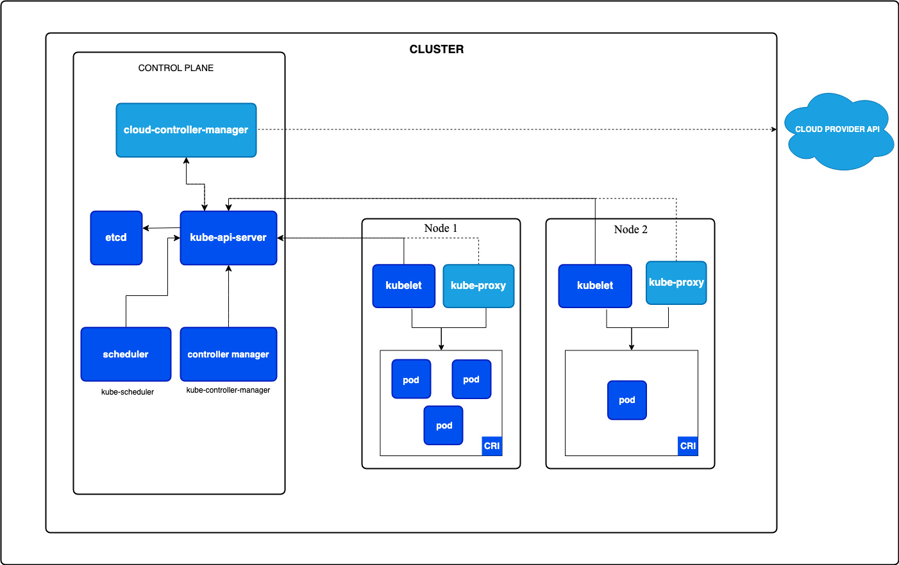

## Big picture: Kubernetes is a control loop

Think of Kubernetes as a system that constantly asks:

> “What did the user declare should exist?”
> “What actually exists right now?”
> “What actions are needed to make reality match the declaration?”

The **control plane** is the brain. It stores desired state, makes decisions, and coordinates the cluster. The **data plane**, also called the worker-node layer, is where your application Pods actually run.

Kubernetes officially describes a cluster as a **control plane plus worker nodes**, with the control plane managing overall state and node components maintaining running Pods and the runtime environment. ([Kubernetes][1])

---

---
# 1. Control plane components

## 1.1 API Server — `kube-apiserver`

The **API server** is the front door of Kubernetes.

Almost everything goes through it:

```text
kubectl
CI/CD tools
Controllers
Scheduler
Kubelets
Operators
Cloud integrations
```

When you run:

```bash
kubectl apply -f deployment.yaml
```

you are not directly creating containers. You are sending a request to the API server. The API server authenticates you, authorizes you, validates the object, runs admission checks, and stores the desired state.

Kubernetes describes `kube-apiserver` as the core server that exposes the Kubernetes HTTP API. ([Kubernetes][1])

### Solid use case

You deploy a new application:

```yaml
apiVersion: apps/v1
kind: Deployment
metadata:
  name: payment-service
spec:
  replicas: 3
```

The API server accepts this desired state. It does **not** personally start containers. Instead, it records the request and lets other control-plane and node components act on it.

### In EKS

In Amazon EKS, AWS manages the Kubernetes API server for you. EKS creates a highly available API endpoint that you access with tools like `kubectl`, and AWS manages availability and replacement of unhealthy control-plane nodes. ([AWS Documentation][2])

---

## 1.2 etcd

**etcd** is the database of Kubernetes.

It stores cluster state, such as:

```text
Deployments
Pods
Services
Secrets
ConfigMaps
Nodes
Namespaces
RBAC rules
PersistentVolumeClaims
```

If the API server is the front door, **etcd is the source of truth**.

Kubernetes describes `etcd` as a consistent and highly available key-value store for all API server data. ([Kubernetes][1])

### Solid use case

You scale an app:

```bash
kubectl scale deployment payment-service --replicas=10
```

That desired replica count is stored in etcd. Controllers then notice that the desired state is now 10 replicas and create more Pods to match it.

### In EKS

AWS manages etcd as part of the EKS control plane. The EKS architecture places at least three etcd instances across three Availability Zones in a Region, which helps protect the cluster state from a single-AZ failure. ([AWS Documentation][3])

---

## 1.3 Controller Manager — `kube-controller-manager`

The **controller manager** runs many controllers.

A controller is a reconciliation loop:

```text
watch desired state
watch actual state
take action if they differ
```

Examples include:

```text
Deployment controller
ReplicaSet controller
Node controller
Job controller
CronJob controller
EndpointSlice controller
Namespace controller
ServiceAccount controller
```

Kubernetes describes `kube-controller-manager` as the component that runs controllers to implement Kubernetes API behavior. ([Kubernetes][1])

### Solid use case

You create this Deployment:

```yaml
replicas: 3
```

But one Pod crashes.

The Deployment and ReplicaSet controllers notice:

```text
desired Pods: 3
actual healthy Pods: 2
```

So they create a replacement Pod. This is one of the main reasons Kubernetes is called **self-healing**.

### In EKS

AWS runs the control-plane controller manager for you. You still create Kubernetes objects, but you do not manage the controller-manager process itself. AWS is responsible for the EKS control plane, including control-plane nodes and etcd, while you remain responsible for the data-plane configuration, nodes, containers, and application security. ([AWS Documentation][4])

---

## 1.4 Scheduler — `kube-scheduler`

The **scheduler** decides which node should run a Pod.

It considers things like:

```text
CPU and memory requests
Node capacity
Taints and tolerations
Node selectors
Node affinity
Pod affinity / anti-affinity
Topology spread constraints
Volume constraints
```

Kubernetes describes `kube-scheduler` as the component that looks for Pods not yet bound to a node and assigns each Pod to a suitable node. ([Kubernetes][1])

### Solid use case

Suppose you deploy a machine-learning Pod that requests a GPU:

```yaml
resources:
  limits:
    nvidia.com/gpu: 1
```

The scheduler will place it only on a node that has an available GPU and satisfies all other scheduling rules.

### In EKS

If your EKS cluster uses EC2 worker nodes, the scheduler chooses among those nodes. If the cluster uses Karpenter or Cluster Autoscaler, unschedulable Pods can cause new EC2 capacity to be provisioned. EKS also supports managed node groups, self-managed nodes, Fargate, Karpenter, EKS Auto Mode, and hybrid nodes as compute options. ([AWS Documentation][3])

---

## 1.5 Cloud Controller Manager — `cloud-controller-manager`

The **cloud controller manager** connects Kubernetes to the cloud provider.

It separates generic Kubernetes logic from cloud-specific logic. Kubernetes describes it as a control-plane component that embeds cloud-specific control logic and links the cluster to the cloud provider API. ([Kubernetes][5])

Typical responsibilities include:

```text
Node controller
Route controller
Service controller
Cloud load balancer integration
Cloud node metadata
Cloud network route management
```

### Solid use case

You create a Service:

```yaml
apiVersion: v1
kind: Service
metadata:
  name: public-api
spec:
  type: LoadBalancer
  selector:
    app: public-api
  ports:
    - port: 80
      targetPort: 8080
```

Kubernetes itself does not know how to create an AWS Network Load Balancer, Azure Load Balancer, or Google Cloud Load Balancer. The cloud integration layer handles that provider-specific work.

### In EKS

On EKS, load balancing can be handled in multiple ways. AWS documentation says the legacy Kubernetes Service Controller is built into the AWS Cloud Provider component, functioning as the Kubernetes Cloud Controller Manager, but AWS recommends using the **AWS Load Balancer Controller** for Service and Ingress reconciliation. ([AWS Documentation][6])

The AWS Load Balancer Controller watches Kubernetes `Ingress` and `Service` resources and creates AWS Elastic Load Balancing resources. It creates ALBs for Ingress resources and NLBs for `Service` resources of type `LoadBalancer`. ([AWS Documentation][7])

In **EKS Auto Mode**, EKS can automatically provision Network Load Balancers for `Service` objects of type `LoadBalancer` without requiring you to install an additional controller. ([AWS Documentation][8])

---

# 2. Data plane components

## 2.1 Kubelet

The **kubelet** runs on every worker node.

Its job is to make sure the Pods assigned to that node are actually running.

The kubelet:

```text
Registers the node with the API server
Watches for Pods assigned to its node
Talks to the container runtime through CRI
Mounts volumes
Runs liveness/readiness/startup probes
Reports Pod and node status back to the API server
Restarts containers when needed
```

Kubernetes describes the kubelet as the node component that ensures Pods are running, including their containers. ([Kubernetes][1])

### Solid use case

The scheduler assigns `payment-service-abc123` to `ip-10-0-1-25`.

The kubelet on `ip-10-0-1-25` sees that assignment and says:

```text
This Pod belongs to me.
I need to ask the runtime to pull the image.
I need to create the containers.
I need to attach volumes.
I need to report status back.
```

If the container crashes, kubelet can restart it according to the Pod’s restart policy.

### In EKS

On EC2-based EKS nodes, kubelet runs on the worker nodes. With managed node groups, AWS helps with lifecycle operations around the EC2 nodes, but the node still runs kubelet and your Pods. With Fargate, AWS abstracts away the underlying node management.

---

## 2.2 Kube-proxy

**kube-proxy** provides Kubernetes Service networking on each node.

A Kubernetes Service gives stable access to a changing set of Pods. Pods come and go, but the Service IP and DNS name stay stable.

Kubernetes describes `kube-proxy` as the optional node component that maintains network rules on nodes to implement Services. ([Kubernetes][1])

### Solid use case

You have three backend Pods:

```text
backend-pod-1: 10.0.2.10
backend-pod-2: 10.0.3.15
backend-pod-3: 10.0.4.20
```

You expose them through a Service:

```text
backend.default.svc.cluster.local
ClusterIP: 172.20.50.10
```

When another Pod calls:

```text
http://backend.default.svc.cluster.local
```

kube-proxy rules help route traffic to one of the healthy backend Pods.

### In EKS

In a common EKS setup, kube-proxy runs as an add-on on nodes and works with AWS VPC CNI networking. When a load balancer targets node instances, traffic may arrive at a node and then be forwarded through kube-proxy’s Service rules to a backend Pod. AWS’s EKS load balancing best-practices guide describes this instance-target path as traffic going from the load balancer to a worker node NodePort, then through iptables rules configured by kube-proxy, and finally to a Pod behind the Service. ([AWS Documentation][6])

---

## 2.3 Container runtime

You did not list this under the data plane, but it is essential.

The **container runtime** actually runs containers.

Examples:

```text
containerd
CRI-O
```

Kubernetes describes the container runtime as node software responsible for running containers. ([Kubernetes][1])

The kubelet does not directly run Linux containers by itself. It asks the runtime to do that.

### Solid use case

Your Pod says:

```yaml
containers:
  - name: api
    image: public.ecr.aws/my-team/api:v1
```

The kubelet tells the container runtime:

```text
Pull this image.
Create the container.
Start the container.
Report container status.
```

### In EKS

For modern EKS EC2 worker nodes, `containerd` is the standard runtime in official EKS optimized AMIs for Kubernetes 1.24 and later. AWS ended dockershim support starting with EKS Kubernetes 1.24, and EKS AMIs for 1.24+ include `containerd` as the only runtime. ([Amazon Web Services, Inc.][9])

---

# 3. The three major Kubernetes interfaces: CRI, CNI, CSI

These interfaces are very important because Kubernetes is designed to be pluggable.

Instead of hard-coding one runtime, one networking system, and one storage system, Kubernetes defines interfaces:

```text
CRI = how kubelet talks to container runtimes
CNI = how Pods get networking
CSI = how Kubernetes uses external storage systems
```

---

# 3.1 CRI — Container Runtime Interface

## What it is

**CRI** is the interface between the kubelet and the container runtime.

Kubernetes says CRI lets kubelet use different container runtimes without recompiling Kubernetes components, and that CRI is the main protocol for communication between kubelet and the container runtime. ([Kubernetes][10])

```text
kubelet
  |
  | CRI
  v
containerd / CRI-O
  |
  v
runc / low-level runtime
  |
  v
Linux namespaces + cgroups
```

## What CRI handles

CRI helps kubelet request operations such as:

```text
Pull image
Create Pod sandbox
Create container
Start container
Stop container
Remove container
Get logs
Get container status
Exec into container
```

## Solid use case 1: Switching runtimes

A company may use `containerd` in production, but another Kubernetes distribution might use CRI-O. Kubernetes does not need to be rewritten because kubelet talks through CRI.

## Solid use case 2: Runtime security

You might use a special runtime class for stronger isolation, such as a sandboxed runtime. The scheduler and kubelet still work with Kubernetes objects, while the runtime layer decides how the container is actually isolated.

## Solid use case 3: Troubleshooting node-level failures

If Pods are stuck in:

```text
ContainerCreating
ImagePullBackOff
CrashLoopBackOff
```

the issue may be at the CRI/runtime layer:

```text
image cannot be pulled
runtime socket unavailable
containerd unhealthy
bad cgroup configuration
runtime cannot create sandbox
```

## In EKS

In EKS, kubelet on EC2 nodes talks to `containerd` through CRI. Your app image might be built with Docker, but Kubernetes does not need Docker Engine to run it. OCI-compatible images can run through `containerd`. AWS explains that dockershim was removed in favor of CRI-compatible runtimes and that EKS 1.24+ AMIs use `containerd` as the only runtime. ([Amazon Web Services, Inc.][9])

---

# 3.2 CNI — Container Network Interface

## What it is

**CNI** is the plugin interface for Pod networking.

Kubernetes says it uses CNI plugins for cluster networking, and a CNI plugin is required to implement the Kubernetes network model. ([Kubernetes][11])

```text
Pod scheduled to node
  |
kubelet asks runtime to create Pod sandbox
  |
runtime invokes CNI plugin
  |
CNI plugin assigns Pod IP and configures networking
  |
Pod can communicate
```

## What CNI handles

CNI plugins commonly handle:

```text
Pod IP allocation
Pod network interface creation
Routing
Network policy enforcement
Pod-to-Pod communication
Pod-to-Service communication
IP address management
```

## Solid use case 1: Pod-to-Pod communication

A frontend Pod on node A needs to talk to a backend Pod on node B.

Without CNI, the frontend Pod may not know how to reach the backend Pod IP. The CNI plugin sets up the networking so Pod IPs are routable according to the cluster’s network model.

## Solid use case 2: Network policy

You want only `frontend` Pods to talk to `payment` Pods on port 443.

A CNI plugin with network-policy support can enforce rules like:

```text
frontend -> payment:443 allowed
random-pod -> payment:443 denied
```

## Solid use case 3: IP exhaustion planning

In cloud environments, Pod IPs often come from a VPC or subnet range. If you run many Pods, you need enough IP addresses. CNI behavior directly affects how many Pods you can place on each node.

## In EKS: Amazon VPC CNI

Amazon EKS commonly uses the **Amazon VPC CNI** plugin. AWS says EKS implements cluster networking through the Amazon VPC CNI and that the plugin allows Kubernetes Pods to have the same IP address inside the Pod as on the VPC network. ([AWS Documentation][12])

On EKS EC2 nodes, the Amazon VPC CNI add-on creates elastic network interfaces and assigns private IPv4 or IPv6 addresses from your VPC to Pods. ([AWS Documentation][13])

That means an EKS Pod can receive a real VPC-routable IP, for example:

```text
Pod IP: 10.0.42.117
VPC CIDR: 10.0.0.0/16
```

This is powerful because Pods can integrate naturally with AWS networking concepts like VPC routing, security groups, subnets, and load balancer target groups.

### EKS CNI example

You deploy:

```yaml
apiVersion: apps/v1
kind: Deployment
metadata:
  name: orders
spec:
  replicas: 3
```

For each Pod:

```text
Scheduler picks a node
Kubelet asks containerd to create the Pod sandbox
containerd invokes CNI
Amazon VPC CNI assigns a VPC IP to the Pod
The Pod becomes reachable inside the VPC
```

---

# 3.3 CSI — Container Storage Interface

## What it is

**CSI** is the standard interface for connecting Kubernetes to storage systems.

CSI lets storage vendors provide drivers without modifying Kubernetes core. The Kubernetes CSI documentation describes CSI as a standard for exposing block and file storage systems to containerized workloads, allowing third-party storage providers to write plugins without touching Kubernetes core code. ([kubernetes-csi.github.io][14])

```text
Pod
  |
PersistentVolumeClaim
  |
StorageClass
  |
CSI driver
  |
Cloud/storage backend
```

## What CSI handles

CSI drivers can handle:

```text
Create volume
Delete volume
Attach volume to node
Detach volume from node
Mount volume into Pod
Unmount volume
Resize volume
Snapshot volume
Restore from snapshot
```

## Solid use case 1: Database persistence

You run PostgreSQL in Kubernetes.

If the Pod dies, you do **not** want the database files to disappear. You create a `PersistentVolumeClaim`, and the CSI driver provisions real storage behind it.

```yaml
apiVersion: v1
kind: PersistentVolumeClaim
metadata:
  name: postgres-data
spec:
  accessModes:
    - ReadWriteOnce
  resources:
    requests:
      storage: 100Gi
```

The Pod can be recreated, but the volume remains.

## Solid use case 2: Storage classes for performance tiers

You might offer different storage classes:

```text
gp3-general
io2-critical-db
efs-shared
```

Developers request storage by class without needing to know every backend detail.

Kubernetes PersistentVolumes abstract how storage is provided from how it is consumed, and StorageClasses let administrators offer different storage properties without exposing backend implementation details directly to users. ([Kubernetes][15])

## Solid use case 3: Shared file storage

Multiple Pods need to read and write shared files, such as uploaded media, ML datasets, or shared reports. A file-based CSI driver can mount shared storage into many Pods.

## In EKS: EBS CSI and EFS CSI

For block storage, EKS commonly uses the **Amazon EBS CSI driver**. AWS says the Amazon EBS CSI driver manages the lifecycle of EBS volumes as storage for Kubernetes volumes, including ephemeral and persistent volumes. ([AWS Documentation][16])

For shared file storage, EKS can use the **Amazon EFS CSI driver**. AWS says Amazon EFS provides serverless elastic file storage, and the EFS CSI driver allows Kubernetes clusters on AWS to mount EFS file systems as persistent volumes. ([AWS Documentation][17])

### EKS CSI example: PostgreSQL with EBS

```text
Developer creates PVC
  |
Kubernetes sees StorageClass: ebs-sc
  |
EBS CSI driver calls AWS EC2 APIs
  |
AWS creates EBS volume
  |
Volume attaches to EC2 worker node
  |
Kubelet mounts volume into PostgreSQL Pod
```

This is ideal for a single-writer database Pod.

### EKS CSI example: shared uploads with EFS

```text
Multiple web Pods need /uploads
  |
PVC uses EFS-backed storage
  |
EFS CSI driver mounts same EFS filesystem into many Pods
  |
All replicas can access shared files
```

This is useful for shared content, reports, model files, or user-uploaded assets.

---

# 4. Connecting all the dots with AWS EKS

Now let’s walk through a realistic EKS application.

Suppose you deploy:

```text
orders-api Deployment
orders Service
PostgreSQL StatefulSet
EBS PersistentVolumeClaim
Internet-facing LoadBalancer Service
```

## Step-by-step flow

### Step 1: You submit YAML

```bash
kubectl apply -f orders-api.yaml
```

`kubectl` sends the request to the **EKS API server**.

```text
kubectl -> EKS API server
```

The API server validates and stores the desired state in **etcd**.

```text
API server -> etcd
```

In EKS, AWS manages this control plane for you, including the API server and etcd. EKS runs the control plane with multiple API server and etcd instances across Availability Zones for resilience. ([AWS Documentation][3])

---

### Step 2: Controllers react

The **Deployment controller** sees:

```text
desired replicas: 3
actual replicas: 0
```

So it creates ReplicaSet and Pod objects.

```text
Controller manager -> creates Pod objects
```

---

### Step 3: Scheduler places Pods

The **scheduler** sees Pods with no assigned node.

It checks:

```text
available nodes
CPU requests
memory requests
affinity rules
taints and tolerations
volume constraints
```

Then it assigns each Pod to a suitable EKS worker node.

```text
Pod orders-api-1 -> node-a
Pod orders-api-2 -> node-b
Pod orders-api-3 -> node-c
```

---

### Step 4: Kubelet starts Pods

The **kubelet** on each selected node sees:

```text
A Pod has been assigned to my node.
```

Then kubelet talks to the container runtime through **CRI**.

```text
kubelet -> CRI -> containerd
```

`containerd` pulls the image and starts the containers.

---

### Step 5: CNI gives each Pod networking

Before the Pod can fully run, it needs networking.

On EKS EC2 nodes, the **Amazon VPC CNI** assigns the Pod a VPC IP address.

```text
containerd invokes CNI
  |
Amazon VPC CNI assigns Pod IP
  |
Pod joins VPC network
```

AWS says the VPC CNI add-on creates ENIs, attaches them to EC2 nodes, and assigns private IPv4 or IPv6 addresses from the VPC to each Pod. ([AWS Documentation][13])

---

### Step 6: CSI provides storage

Your PostgreSQL Pod needs persistent disk.

The Pod uses a PVC:

```yaml
kind: PersistentVolumeClaim
metadata:
  name: postgres-data
```

The **EBS CSI driver** provisions an EBS volume, attaches it to the EC2 node, and kubelet mounts it into the Pod.

```text
PVC -> StorageClass -> EBS CSI driver -> EBS volume -> Pod mount
```

AWS says the EBS CSI driver manages the lifecycle of EBS volumes for Kubernetes volumes. ([AWS Documentation][16])

---

### Step 7: Service networking works through kube-proxy

Your API Pods are exposed internally through a Kubernetes Service:

```text
orders.default.svc.cluster.local
```

kube-proxy maintains the node-level rules that route traffic from the Service to the healthy backend Pods.

```text
client Pod -> Service IP -> kube-proxy rules -> orders-api Pod
```

---

### Step 8: External traffic enters through AWS load balancing

You create:

```yaml
kind: Service
spec:
  type: LoadBalancer
```

In standard EKS, the recommended approach is usually the **AWS Load Balancer Controller**, which watches Kubernetes `Service` and `Ingress` resources and provisions AWS load balancers. ([AWS Documentation][7])

For example:

```text
Internet user
  |
AWS Network Load Balancer
  |
EKS Service
  |
orders-api Pods
```

In EKS Auto Mode, EKS can automatically provision and configure an AWS Network Load Balancer for a `Service` of type `LoadBalancer` without you installing a separate controller. ([AWS Documentation][8])

---

# 5. EKS responsibility model

A key part of understanding EKS is knowing what AWS manages and what you manage.

## AWS-managed in EKS

```text
Kubernetes control plane
API server
etcd
Control-plane scaling
Control-plane availability
Control-plane patching/replacement
```

AWS says it is responsible for the EKS Kubernetes control plane, including control-plane nodes and the etcd database. ([AWS Documentation][4])

## You usually manage

```text
Application YAML
Namespaces
RBAC
Pods and Deployments
Services and Ingresses
Worker node configuration, unless abstracted by Fargate or Auto Mode
Container images
Runtime security
Network policies
IAM permissions for workloads
Storage classes and PVCs
Add-ons, unless using managed add-ons or Auto Mode
```

AWS says your responsibility includes data-plane security configuration, node and container configuration, node operating system updates and patches, firewall rules, platform IAM, and application software. ([AWS Documentation][4])

---

# 6. One-page mental model

```text
You:
  kubectl apply -f app.yaml
        |
        v
EKS Control Plane:
  API Server
    - receives Kubernetes API requests
    - validates and stores desired state
        |
        v
  etcd
    - stores cluster state
        |
        v
  Controller Manager
    - notices desired vs actual state
    - creates/updates Kubernetes objects
        |
        v
  Scheduler
    - chooses worker nodes for Pods
        |
        v
EKS Data Plane:
  Kubelet
    - sees assigned Pods
    - asks runtime to start containers
        |
        v
  CRI -> containerd
    - pulls images
    - starts containers
        |
        v
  CNI -> Amazon VPC CNI
    - gives Pods IP addresses
    - connects Pods to VPC networking
        |
        v
  CSI -> EBS/EFS CSI
    - creates and mounts storage
        |
        v
  kube-proxy
    - implements Service routing
        |
        v
AWS integrations:
  AWS Load Balancer Controller / EKS Auto Mode
    - creates ALB/NLB for external traffic
```

---

# 7. Simple analogy

Think of EKS like a managed airport.

```text
API Server = airport control tower
etcd = official flight schedule database
Scheduler = gate assignment system
Controller Manager = operations team keeping everything as planned
Cloud Controller Manager = team that talks to AWS infrastructure
Kubelet = ground crew on each gate
Container Runtime = machinery that actually loads and starts the aircraft
CNI = runway/taxiway/network assignment
CSI = baggage/cargo storage system
kube-proxy = internal shuttle/routing system
```

In plain English:

> You declare what you want.
> The control plane records and coordinates it.
> The scheduler chooses where it should run.
> Kubelet makes it run.
> CRI starts containers.
> CNI gives networking.
> CSI gives storage.
> kube-proxy and load balancers make it reachable.
> EKS manages much of the Kubernetes control-plane complexity for you.

[1]: https://kubernetes.io/docs/concepts/overview/components/ "Kubernetes Components | Kubernetes"
[2]: https://docs.aws.amazon.com/eks/latest/best-practices/control-plane.html "EKS Control Plane - Amazon EKS"
[3]: https://docs.aws.amazon.com/eks/latest/userguide/eks-architecture.html "Amazon EKS architecture - Amazon EKS"
[4]: https://docs.aws.amazon.com/eks/latest/userguide/security.html "Security in Amazon EKS - Amazon EKS"
[5]: https://kubernetes.io/docs/concepts/architecture/cloud-controller/ "Cloud Controller Manager | Kubernetes"
[6]: https://docs.aws.amazon.com/eks/latest/best-practices/load-balancing.html "Load Balancing - Amazon EKS"
[7]: https://docs.aws.amazon.com/eks/latest/userguide/aws-load-balancer-controller.html "Route internet traffic with AWS Load Balancer Controller - Amazon EKS"
[8]: https://docs.aws.amazon.com/eks/latest/userguide/auto-configure-nlb.html "Use Service Annotations to configure Network Load Balancers - Amazon EKS"
[9]: https://aws.amazon.com/blogs/containers/all-you-need-to-know-about-moving-to-containerd-on-amazon-eks/ "All you need to know about moving to containerd on Amazon EKS | Containers"
[10]: https://kubernetes.io/docs/concepts/containers/cri/ "Container Runtime Interface (CRI) | Kubernetes"
[11]: https://kubernetes.io/docs/concepts/extend-kubernetes/compute-storage-net/network-plugins/ "Network Plugins | Kubernetes"
[12]: https://docs.aws.amazon.com/eks/latest/best-practices/vpc-cni.html "Amazon VPC CNI - Amazon EKS"
[13]: https://docs.aws.amazon.com/eks/latest/userguide/managing-vpc-cni.html "Assign IPs to Pods with the Amazon VPC CNI - Amazon EKS"
[14]: https://kubernetes-csi.github.io/docs/ "Introduction - Kubernetes CSI Developer Documentation"
[15]: https://kubernetes.io/docs/concepts/storage/persistent-volumes/ "Persistent Volumes | Kubernetes"
[16]: https://docs.aws.amazon.com/eks/latest/userguide/ebs-csi.html "Use Kubernetes volume storage with Amazon EBS - Amazon EKS"
[17]: https://docs.aws.amazon.com/eks/latest/userguide/efs-csi.html "Use elastic file system storage with Amazon EFS - Amazon EKS"
